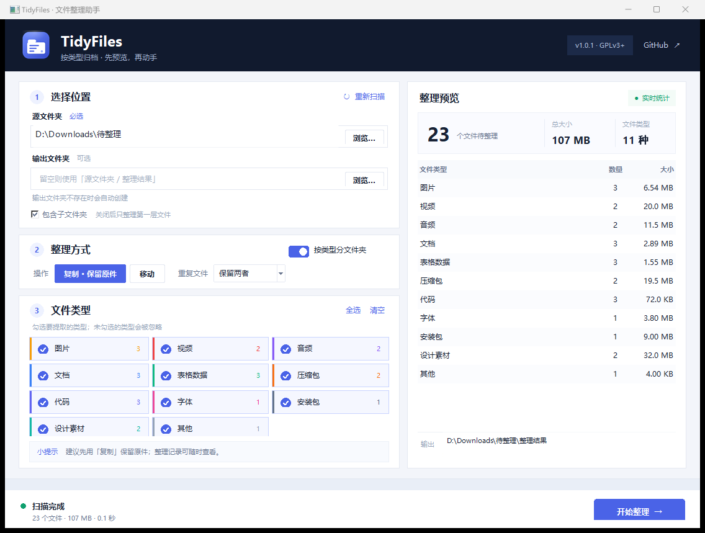

<p align="center">
  
</p>

<h1 align="center">TidyFiles · 文件整理助手</h1>

<p align="center">
  选择文件夹，按类型归档；先预览，再复制或移动。
</p>

<p align="center">
  <a href="https://github.com/Artorias-Adon/tidyfiles/actions/workflows/tests.yml"></a>
  <a href="https://www.python.org/"></a>
  <a href="LICENSE"></a>
</p>

<p align="center">
  
  <br>
  <sub>界面截图使用演示路径与示例文件。</sub>
</p>

TidyFiles 是一个**完全本地运行**的桌面文件整理工具。选择一个下载文件夹、截图文件夹或任何杂乱的目录，它会扫描文件、按类型统计，并在你确认后把文件复制或移动到新的分类文件夹中。

没有上传、没有账号、没有第三方 Python 依赖。界面使用 Tkinter，同时提供可脚本化的命令行工具。

---

## 功能亮点

- **选择任意文件夹**：支持递归扫描子文件夹，也可以只整理第一层。
- **11 种文件类型**：图片、视频、音频、文档、表格数据、压缩包、代码、字体、安装包、设计素材、其他。
- **类型级筛选**：实时显示每种类型的文件数和体积，自由勾选要整理的类型。
- **可选择的分类方式**：按类型创建子文件夹，或关闭分类后全部放入同一层。
- **复制 / 移动**：默认**复制并保留原件**；移动前有明确警告。
- **先预览，后动手**：执行前展示数量、体积、输出路径与目标分类。
- **重复文件可选策略**：保留两者、略过新文件或覆盖旧文件，默认保留两者。
- **不会重复整理输出目录**：输出文件夹位于源目录内时会被自动排除。
- **原子复制**：先写临时文件再替换，降低中断导致半截文件的风险。
- **完整整理记录**：每次执行生成 JSON 报告，记录来源、目标、状态和错误。
- **中文界面 + CLI**：桌面使用简单，也方便批处理或接入自动化。
- **跨平台**：Windows、macOS、Linux；Windows 提供双击启动脚本。

## 快速开始

### 环境要求

- Python **3.10+**
- Tkinter（Windows 和 macOS 官方 Python 通常自带；Linux 见下方说明）

### 方式一：直接运行源码

```bash
git clone https://github.com/Artorias-Adon/tidyfiles.git
cd tidyfiles
python main.py
```

Windows 用户也可以双击 **`start.bat`**，或在终端运行：

```powershell
.\start.bat
```

Linux 如果提示缺少 Tkinter：

```bash
sudo apt install python3-tk      # Debian / Ubuntu
sudo dnf install python3-tkinter # Fedora
```

macOS / Linux 还可以运行：

```bash
chmod +x start.sh
./start.sh
```

### 方式二：安装为命令

```bash
pip install .
tidyfiles          # 无参数时打开图形界面；有参数时进入 CLI
tidyfiles-gui      # 始终打开图形界面
tidyfiles-cli -h   # 始终使用命令行
```

## 使用步骤

1. **选择源文件夹**：点击「浏览…」，或直接粘贴路径后按 Enter / 点击「重新扫描」。
2. **选择输出文件夹（可选）**：留空时自动使用 `源文件夹/整理结果`。
3. **设置整理方式**：选择「复制 · 保留原件」或「移动」；设置重复文件策略。
4. **勾选文件类型**：左侧类型卡片会显示实时数量。点击「全选 / 清空」快速切换。
5. **检查预览**：右侧会汇总待整理文件数、总大小、类型和输出位置。
6. **点击「开始整理」**：确认后执行；过程中可取消，已完成文件不会自动回滚。

> 建议第一次使用时保留默认的「复制」模式，确认输出结果无误后再考虑移动。

### 重复文件处理

当输出目录中已经存在同名文件时，可以在界面右下角选择一种策略：

| 策略 | 行为 |
| --- | --- |
| **保留两者**（默认） | 保留旧文件，新文件自动重命名为 `photo (1).jpg` 后导入 |
| **略过新文件** | 保留旧文件，不导入新文件；计入“略过”数量 |
| **覆盖旧文件** | 用新文件替换旧文件；请谨慎使用 |

同一批整理中出现多个同名文件时，程序也会自动避让，不会让后一个文件覆盖刚导入的前一个文件。

## 默认分类规则

| 分类 | 输出文件夹 | 常见扩展名 |
| --- | --- | --- |
| 图片 | `图片/` | jpg, jpeg, png, gif, webp, svg, heic, raw … |
| 视频 | `视频/` | mp4, mkv, avi, mov, webm, m4v … |
| 音频 | `音频/` | mp3, wav, flac, aac, ogg, m4a … |
| 文档 | `文档/` | pdf, docx, pptx, txt, md, epub … |
| 表格数据 | `表格数据/` | xlsx, csv, json, yaml, xml, sqlite … |
| 压缩包 | `压缩包/` | zip, rar, 7z, tar, gz, iso … |
| 代码 | `代码/` | py, js, ts, html, css, java, cpp, go, rs … |
| 字体 | `字体/` | ttf, otf, woff, woff2, ttc … |
| 安装包 | `安装包/` | exe, msi, apk, dmg, deb, rpm … |
| 设计素材 | `设计素材/` | psd, ai, fig, blend, stl, dwg, step … |
| 其他 | `其他/` | 未匹配到以上类型的文件 |

分类表位于 [`tidyfiles/categories.py`](tidyfiles/categories.py)，欢迎通过 PR 补充常见扩展名。

## 命令行用法

```bash
# 只预览，不写入任何文件
python -m tidyfiles -s "D:\Downloads" --dry-run

# 复制图片和文档到指定目录
python -m tidyfiles -s "D:\Downloads" -d "D:\Sorted" --types images,documents

# 移动所有文件，遇到重复文件时略过新文件，不扫描子文件夹
python -m tidyfiles -s "D:\Downloads" --move --conflict skip --no-recursive

# 不按类型建子文件夹
python -m tidyfiles -s "D:\Downloads" -d "D:\Sorted" --flat

# 查看所有类型 key / 文件夹名 / 扩展名
python -m tidyfiles --list-types

# 查看完整参数
python -m tidyfiles --help
```

安装后也可以使用 `tidyfiles-cli` 代替 `python -m tidyfiles`。

可用参数：

| 参数 | 说明 |
| --- | --- |
| `-s, --source` | 源文件夹（必填） |
| `-d, --dest` | 输出文件夹，默认 `源/整理结果` |
| `--move` | 移动而不是复制 |
| `--flat` | 不创建类型子文件夹 |
| `--no-recursive` | 只处理第一层文件 |
| `--types` | 逗号分隔的类型 key 或中文名，如 `images,文档` |
| `--conflict` | `rename`=保留两者（默认）/ `skip`=略过新文件 / `overwrite`=覆盖旧文件 |
| `--dry-run` | 只输出计划，不写入 |
| `--list-types` | 列出内置分类 |

## 安全设计

TidyFiles 会尽量把“整理文件”这件事做得可预期：

- **默认复制**：不移动、不删除源文件。
- **开始前预览**：扫描阶段只读取文件名、大小和类型，不写入磁盘。
- **输出目录排除**：输出目录如果在源目录中，扫描时会跳过它，避免把上次结果再次分类。
- **源目录保护**：输出目录不能与源目录完全相同。
- **原子复制**：先复制为同目录临时文件，再原子替换目标文件；失败时清理临时文件。
- **批处理不中断**：单个文件被占用或无权限时记录失败并继续处理其他文件。
- **同名保护**：默认保留两者，新文件按 `photo (1).jpg` 自动重命名；同一批里出现同名文件也不会互相覆盖。
- **JSON 整理记录**：每次执行都会保存报告，方便审计或排查。

**移动模式没有自动撤销功能。** 如果你需要可回退的整理，请使用复制模式。

## 配置与整理记录

应用设置会在关闭窗口时保存；整理报告在每次执行后写入本机用户数据目录：

| 系统 | 路径 |
| --- | --- |
| Windows | `%APPDATA%\TidyFiles\reports\` |
| macOS | `~/Library/Application Support/TidyFiles/reports/` |
| Linux | `${XDG_DATA_HOME:-~/.local/share}/TidyFiles/reports/` |

设置文件位于同一 `TidyFiles` 目录下的 `settings.json`。报告文件为 UTF-8 JSON，包含源路径、目标路径、执行方式、汇总信息和逐文件状态。

## 项目结构

```text
tidyfiles/
├── main.py                  # 图形界面入口
├── tidyfiles/
│   ├── __main__.py          # 有参数走 CLI，无参数开 GUI
│   ├── categories.py        # 分类表与扩展名匹配
│   ├── organizer.py         # 扫描、计划、复制/移动、报告
│   ├── gui.py               # Tkinter 桌面界面
│   ├── widgets.py           # 自绘按钮、开关、类型卡片
│   ├── cli.py               # 命令行界面
│   ├── settings.py          # 设置持久化
│   ├── paths.py             # 平台路径与显示辅助
│   └── assets/              # 图标资源
├── tests/test_core.py       # 引擎、计划、冲突、报告与设置测试
├── screenshots/             # README 截图
├── .github/workflows/       # GitHub Actions
├── start.bat / start.sh
├── pyproject.toml
├── NOTICE                   # 版权与 GPL-3.0-or-later 声明
└── LICENSE                  # GNU GPL v3 完整条款
```

核心引擎不依赖 Tkinter，GUI 与 CLI 共用同一套扫描和执行逻辑。

## 开发与测试

```bash
python -m unittest discover -s tests -v
```

测试覆盖：

- 扩展名识别、大小写与无扩展名文件
- 递归 / 非递归扫描、输出目录排除、取消扫描
- 类型筛选与平铺计划
- 复制、移动、中文文件名
- 重复文件保留两者 / 略过新文件 / 覆盖旧文件
- 同一批同名文件保护
- 取消执行、源文件消失、无效输出路径
- JSON 报告、设置读写、UTF-8 BOM 兼容、路径截断

GitHub Actions 会在 Ubuntu 与 Windows、Python 3.10 与 3.12 上运行测试。

### 打包 Windows 可执行文件（可选）

```powershell
pip install pyinstaller
pyinstaller --noconfirm --windowed --name TidyFiles `
  --icon "tidyfiles/assets/icon.ico" `
  --add-data "tidyfiles/assets;tidyfiles/assets" `
  main.py
```

生成的程序位于 `dist/TidyFiles/`。

## 常见问题

**会删除我的文件吗？**

复制模式不会。只有主动选择「移动」并确认后，源文件才会被移除；移动无法自动撤销。

**输出目录可以放在源目录里面吗？**

可以。TidyFiles 会自动排除该目录，不会把整理结果再次整理。输出目录不能与源目录完全相同。

**为什么某些文件进了「其他」？**

该扩展名尚未加入分类表。可以在 [`tidyfiles/categories.py`](tidyfiles/categories.py) 中补充，或提交 Issue。

**支持自定义分类吗？**

当前版本使用内置分类表；分类的显示与扩展名可以在源码中调整，CLI 与 GUI 会同步生效。

**扫描很慢怎么办？**

关闭「包含子文件夹」，或先把目标缩小到具体目录。扫描在后台线程进行，界面不会卡死。

## English

**TidyFiles** is a local-first desktop folder organizer built with Python and
Tkinter. Pick a folder, preview files grouped by type, optionally filter the
types, then copy or move them into clean category folders. It ships with a GUI
and a scriptable CLI, has no third-party runtime dependencies, and never
uploads your data.

Highlights: 11 file categories, live preview, copy/move modes, conflict
policies, atomic copies, JSON reports, Chinese UI, cross-platform support.

```bash
git clone https://github.com/Artorias-Adon/tidyfiles.git
cd tidyfiles
python main.py

python -m tidyfiles -s "/path/to/inbox" --dry-run
```

See the Chinese sections above for the full usage guide, safety notes, and
development instructions.

TidyFiles is licensed under the **GNU General Public License v3.0 or later**
(GPL-3.0-or-later).

## 贡献

欢迎提交 Issue 和 Pull Request。请先阅读 [CONTRIBUTING.md](CONTRIBUTING.md)，并在提交前运行测试。

如果 TidyFiles 对你有帮助，欢迎点一个 Star ⭐。

## License

TidyFiles 采用 [GNU General Public License v3.0 or later](LICENSE)
（**GPL-3.0-or-later**）授权，版权声明见 [NOTICE](NOTICE)。

你可以自由使用、修改和分发本软件；衍生作品需要继续以相同许可证开源。
本软件不提供任何担保，完整条款以 [LICENSE](LICENSE) 为准。

Copyright (C) 2026 Artorias-Adon
